```markdown
# Pharmacy Inventory and Sales Management System

## Assignment III: SQL Table Manipulation

### Project Overview

| Field | Details |
| --- | --- |
| Project Title | Pharmacy Inventory and Sales Management System |
| Student Name | Safi Alkhalefa |
| Student ID | [Your Student ID] |
| Business Idea | Pharmacy Management System |
| DBMS | PostgreSQL |
| Instructor | Eric Maniraguha |
| Institution | Kigali Independent University (ULK) |

---

## Table of Contents

1. [Database & Table Design](#database--table-design)
2. [Database Creation](#database-creation)
3. [Initial Data Insertion](#initial-data-insertion)
4. [SQL Practical Tasks](#sql-practical-tasks)
5. [Conclusion](#conclusion)

---

## Database & Table Design

### 1. Database Name

```sql
safialkhalefa_[your_student_id]_pharmacy_system
```

### 2. Tables and Purposes

| Table | Type | Purpose |
| --- | --- | --- |
| `categories` | Parent table | Stores pharmaceutical drug categories such as Antibiotics, Painkillers, and Vitamins. |
| `medicines` | Child of `categories` and parent of `sales` | Stores product details including name, price, stock quantity, and category reference. |
| `sales` | Child of `medicines` | Stores customer transactions with medicine reference, quantity sold, and sale date. |

### 3. Key Relationships

- `categories.category_id` — Primary key
- `medicines.medicine_id` — Primary key
- `medicines.category_id` — Foreign key to `categories(category_id)`
- `sales.sale_id` — Primary key
- `sales.medicine_id` — Foreign key to `medicines(medicine_id)`

These relationships ensure referential integrity and maintain the parent-child structure of the database.

### 4. Entity Relationship Diagram (ERD)

The ERD was generated directly from pgAdmin 4 before the `ALTER TABLE` modifications were applied.


---

## Database Creation

### 1. Create the Database

```sql
CREATE DATABASE safialkhalefa_pharmacy_system;
```

### 2. Create the Tables

```sql
CREATE TABLE categories (
    category_id SERIAL PRIMARY KEY,
    category_name VARCHAR(100) NOT NULL UNIQUE,
    description TEXT
);

CREATE TABLE medicines (
    medicine_id SERIAL PRIMARY KEY,
    medicine_name VARCHAR(150) NOT NULL,
    unit_price NUMERIC(10, 2) NOT NULL CHECK (unit_price > 0),
    stock_quantity INT NOT NULL CHECK (stock_quantity >= 0),
    category_id INT NOT NULL,
    CONSTRAINT fk_medicines_categories FOREIGN KEY (category_id)
        REFERENCES categories(category_id)
        ON DELETE RESTRICT
        ON UPDATE CASCADE
);

CREATE TABLE sales (
    sale_id SERIAL PRIMARY KEY,
    medicine_id INT NOT NULL,
    customer_name VARCHAR(120) NOT NULL,
    quantity_sold INT NOT NULL CHECK (quantity_sold > 0),
    sale_date DATE NOT NULL,
    CONSTRAINT fk_sales_medicines FOREIGN KEY (medicine_id)
        REFERENCES medicines(medicine_id)
        ON DELETE RESTRICT
        ON UPDATE CASCADE
);
```

---

## Initial Data Insertion

Five initial records were inserted into each table in parent-to-child order.

```sql
INSERT INTO categories (category_name, description) VALUES
('Antibiotics', 'Medicines that inhibit the growth of or destroy microorganisms'),
('Painkillers', 'Analgesic drugs used to achieve relief from pain'),
('Vitamins', 'Nutritional supplements that support human growth and health'),
('Antihistamines', 'Medications used to treat allergy symptoms'),
('Antacids', 'Agents that neutralize stomach acidity to relieve heartburn');

INSERT INTO medicines (medicine_name, unit_price, stock_quantity, category_id) VALUES
('Amoxicillin 500mg', 12.50, 80, 1),
('Paracetamol 500mg', 3.00, 200, 2),
('Ibuprofen 400mg', 5.50, 150, 2),
('Vitamin C 1000mg', 8.00, 95, 3),
('Cetirizine 10mg', 4.50, 40, 4);

INSERT INTO sales (medicine_id, customer_name, quantity_sold, sale_date) VALUES
(1, 'Jean Paul Mugisha', 2, '2026-10-24'),
(2, 'Claire Ingabire', 4, '2026-10-24'),
(2, 'David Habimana', 1, '2026-10-25'),
(3, 'Grace Uwera', 3, '2026-10-25'),
(4, 'Emmanuel Ndahiro', 2, '2026-10-25');
```

---

## SQL Practical Tasks

### 1. SELECT — Basic Data Retrieval

#### Q1.1: Basic Data Retrieval

- Objective: Retrieve `medicine_name`, `unit_price`, and `stock_quantity` from the `medicines` table.
- SQL:

```sql
SELECT medicine_name, unit_price, stock_quantity
FROM medicines;
```

- Execution evidence: 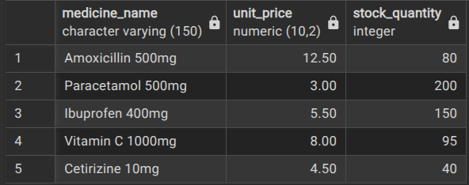
- Explanation: Displays the current inventory pricing and stock availability without exposing internal database keys.

#### Q1.2: Conditional Data Retrieval

- Objective: Retrieve medicines costing more than `5.00` and with available stock below `100` units.
- SQL:

```sql
SELECT medicine_name, unit_price, stock_quantity
FROM medicines
WHERE unit_price > 5.00 AND stock_quantity < 100;
```

- Execution evidence: 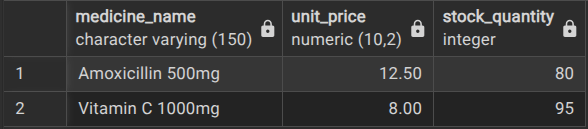
- Explanation: Uses `WHERE` with `AND` to filter high-value stock items that require reordering.

#### Q1.3: Sorted Data Retrieval

- Objective: Retrieve all medicines ordered by `unit_price` in descending order.
- SQL:

```sql
SELECT medicine_id, medicine_name, unit_price, stock_quantity
FROM medicines
ORDER BY unit_price DESC;
```

- Execution evidence: 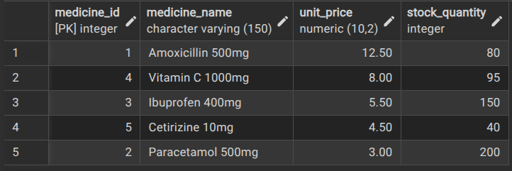
- Explanation: Organizes inventory from highest to lowest price using `ORDER BY ... DESC`.

---

### 2. JOIN — Retrieving Related Data

#### Q2.1: INNER JOIN

- Objective: Retrieve medicines alongside their category names.
- SQL:

```sql
SELECT m.medicine_id, m.medicine_name, m.unit_price, c.category_name
FROM medicines m
INNER JOIN categories c ON m.category_id = c.category_id;
```

- Execution evidence: 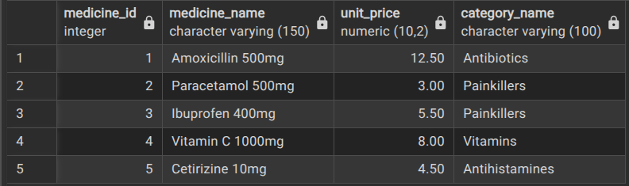
- Explanation: Matches records across both tables and links each medicine to its category.

#### Q2.2: LEFT JOIN

- Objective: Show all categories and any related medicines, while keeping categories without products visible.
- SQL:

```sql
SELECT c.category_name, m.medicine_name, m.unit_price
FROM categories c
LEFT JOIN medicines m ON c.category_id = m.category_id;
```

- Execution evidence: 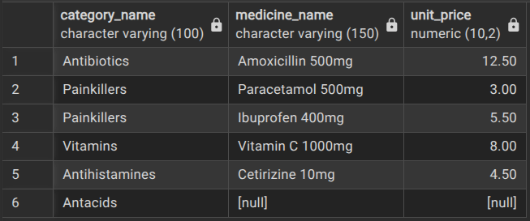
- Explanation: Keeps all category records visible while showing `NULL` values where no medicine exists.

#### Q2.3: Multi-Table JOIN

- Objective: Combine `sales`, `medicines`, and `categories` into a transaction summary report.
- SQL:

```sql
SELECT
    s.sale_id,
    s.sale_date,
    s.customer_name,
    m.medicine_name,
    c.category_name,
    s.quantity_sold,
    m.unit_price,
    (s.quantity_sold * m.unit_price) AS total_amount
FROM sales s
INNER JOIN medicines m ON s.medicine_id = m.medicine_id
INNER JOIN categories c ON m.category_id = c.category_id
ORDER BY s.sale_date ASC;
```

- Execution evidence: 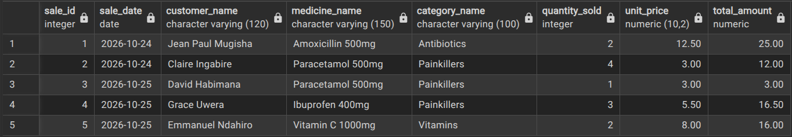
- Explanation: Connects multiple related tables and calculates the amount for each transaction.

---

### 3. UPDATE — Modifying Existing Data

#### Q3.1: Update One Record

- Objective: Update the unit price of Paracetamol 500mg (`medicine_id = 2`) to `3.50`.
- SQL:

```sql
UPDATE medicines
SET unit_price = 3.50
WHERE medicine_id = 2;
```

- Verification query:

```sql
SELECT medicine_id, medicine_name, unit_price
FROM medicines
WHERE medicine_id = 2;
```

- Execution evidence: 
- Explanation: Updates a single record safely using its primary key.

#### Q3.2: Update Multiple Records

- Objective: Restock low-stock items by adding 30 units to medicines with stock below 50.
- SQL:

```sql
UPDATE medicines
SET stock_quantity = stock_quantity + 30
WHERE stock_quantity < 50;
```

- Verification query:

```sql
SELECT medicine_id, medicine_name, stock_quantity
FROM medicines;
```

- Execution evidence: 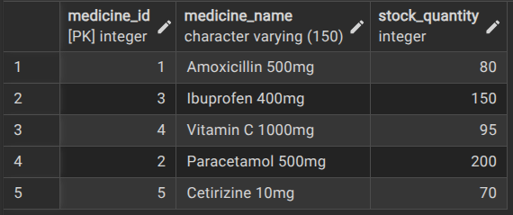
- Explanation: Updates all matching records at once using a single conditional rule.

#### Q3.3: Conditional Update (Business Rule)

- Objective: Apply a 10% discount to all medicines in the Painkillers category.
- SQL:

```sql
UPDATE medicines
SET unit_price = ROUND(unit_price * 0.90, 2)
WHERE category_id = 2;
```

- Verification query:

```sql
SELECT medicine_id, medicine_name, unit_price, category_id
FROM medicines
WHERE category_id = 2;
```

- Execution evidence: 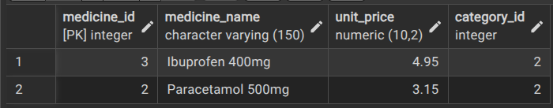
- Explanation: Applies a category-wide promotional discount policy to all Painkiller items.

---

### 4. ALTER TABLE — Modifying the Schema

#### Q4.1: Rename a Column

- Objective: Rename the `description` column in `categories` to `category_description`.
- SQL:

```sql
ALTER TABLE categories
RENAME COLUMN description TO category_description;
```

- Verification query:

```sql
SELECT category_id, category_name, category_description
FROM categories
LIMIT 3;
```

- Execution evidence: 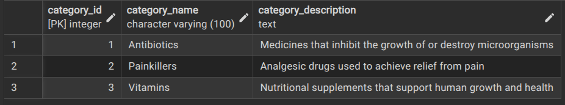
- Explanation: Improves clarity of column naming without changing stored values.

#### Q4.2: Change a Column Data Type

- Objective: Widen `customer_name` from `VARCHAR(120)` to `VARCHAR(180)`.
- SQL:

```sql
ALTER TABLE sales
ALTER COLUMN customer_name TYPE VARCHAR(180);
```

- Verification query:

```sql
SELECT column_name, data_type, character_maximum_length
FROM information_schema.columns
WHERE table_name = 'sales' AND column_name = 'customer_name';
```

- Execution evidence: 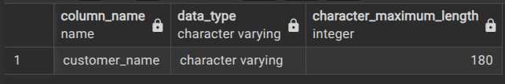
- Explanation: Expands the field size while preserving the existing data.

#### Q4.3: Add a Column

- Objective: Add an `expiry_date` column to the `medicines` table with a default value.
- SQL:

```sql
ALTER TABLE medicines
ADD COLUMN expiry_date DATE DEFAULT '2028-12-31';
```

- Verification query:

```sql
SELECT medicine_id, medicine_name, expiry_date
FROM medicines
LIMIT 3;
```

- Execution evidence: 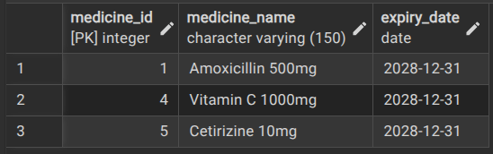
- Explanation: Adds a useful shelf-life field for inventory management.

---

### 5. INSERT — Adding New Records

#### Q5.1: Insert a Single Record

- Objective: Insert a new category into the parent table.
- SQL:

```sql
INSERT INTO categories (category_name, category_description)
VALUES ('Cardiovascular', 'Drugs used to treat conditions of the heart and blood vessels');
```

- Verification query:

```sql
SELECT *
FROM categories
WHERE category_name = 'Cardiovascular';
```

- Execution evidence: 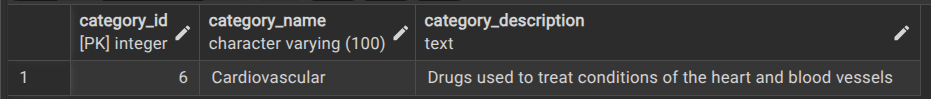
- Explanation: Inserts one parent-row record while allowing the primary key to auto-increment.

#### Q5.2: Insert Multiple Records

- Objective: Insert multiple medicine records in a single statement.
- SQL:

```sql
INSERT INTO medicines (medicine_name, unit_price, stock_quantity, category_id, expiry_date) VALUES
('Amlodipine 5mg', 9.50, 60, 6, '2028-06-30'),
('Omeprazole 20mg', 6.00, 110, 5, '2027-11-15');
```

- Verification query:

```sql
SELECT *
FROM medicines
WHERE medicine_name IN ('Amlodipine 5mg', 'Omeprazole 20mg');
```

- Execution evidence: 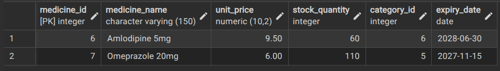
- Explanation: Adds multiple rows efficiently while keeping valid foreign key references.

#### Q5.3: Insert a Related Record

- Objective: Insert a sales transaction referencing a newly added medicine.
- SQL:

```sql
INSERT INTO sales (medicine_id, customer_name, quantity_sold, sale_date)
VALUES (6, 'Patrick Kayitare', 1, '2026-10-26');
```

- Verification query:

```sql
SELECT s.sale_id, s.customer_name, s.quantity_sold, m.medicine_name, s.sale_date
FROM sales s
INNER JOIN medicines m ON s.medicine_id = m.medicine_id
WHERE s.customer_name = 'Patrick Kayitare';
```

- Execution evidence: 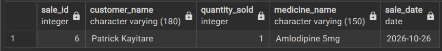
- Explanation: Demonstrates referential integrity by inserting a valid child record linked to the parent table.

---

## Conclusion

This assignment focused on designing and implementing a relational database for a Pharmacy Management System using PostgreSQL. The project strengthened key database skills, including creating parent and child tables, enforcing referential integrity through primary and foreign keys, retrieving and filtering data with `SELECT`, `WHERE`, and `JOIN`, applying updates safely, and modifying database structure using `ALTER TABLE`.
```
